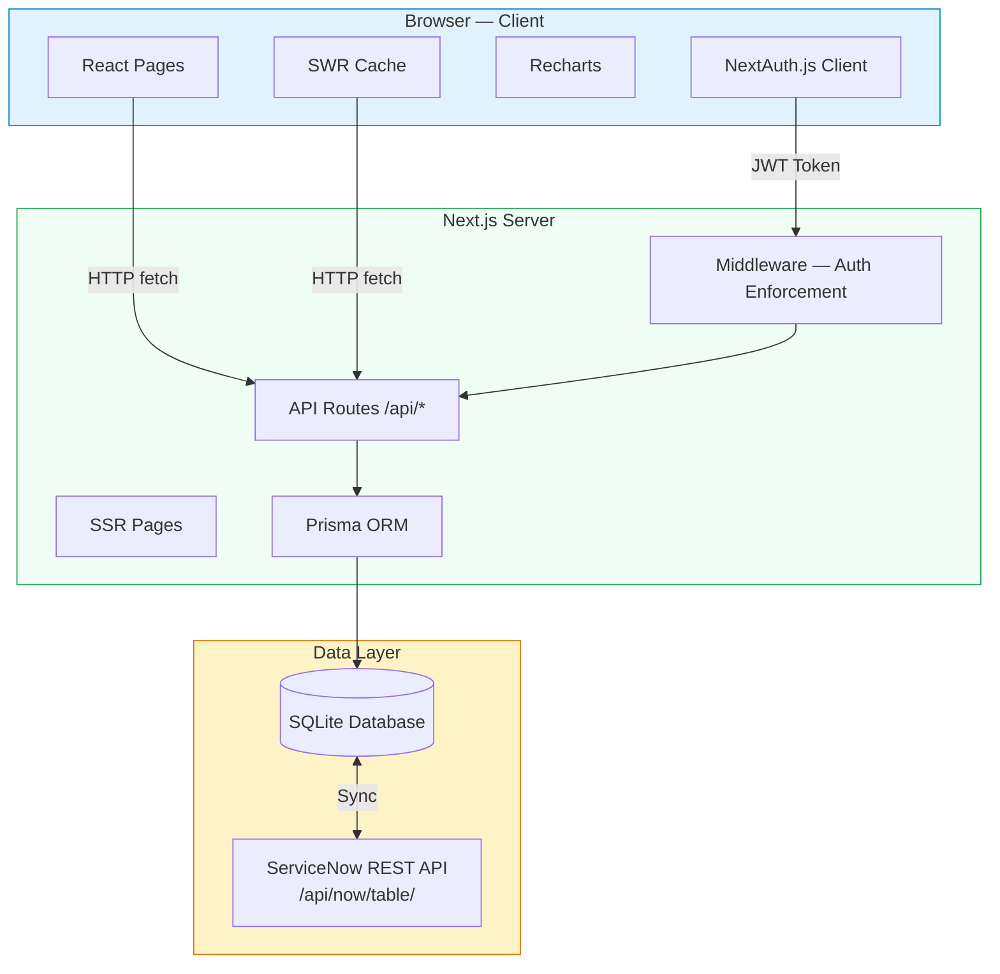
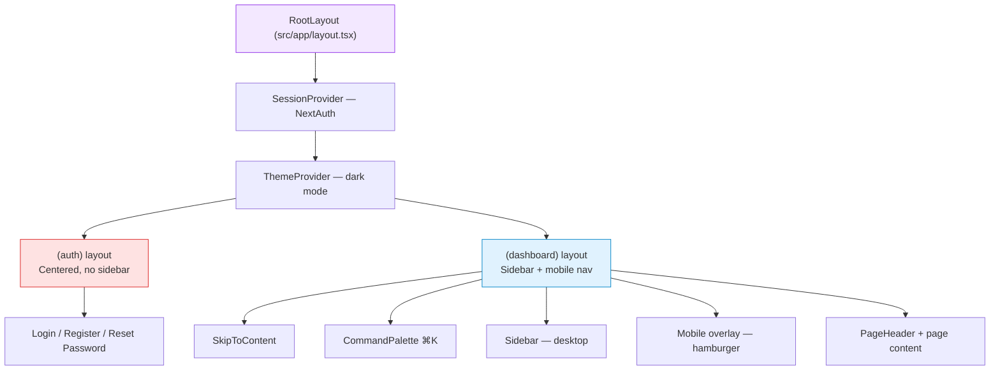
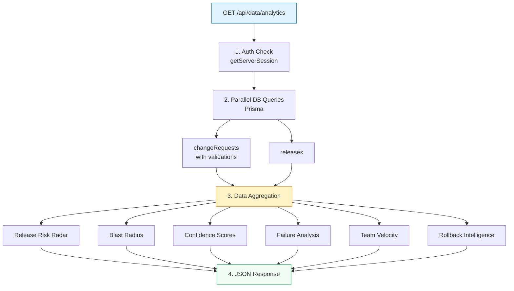
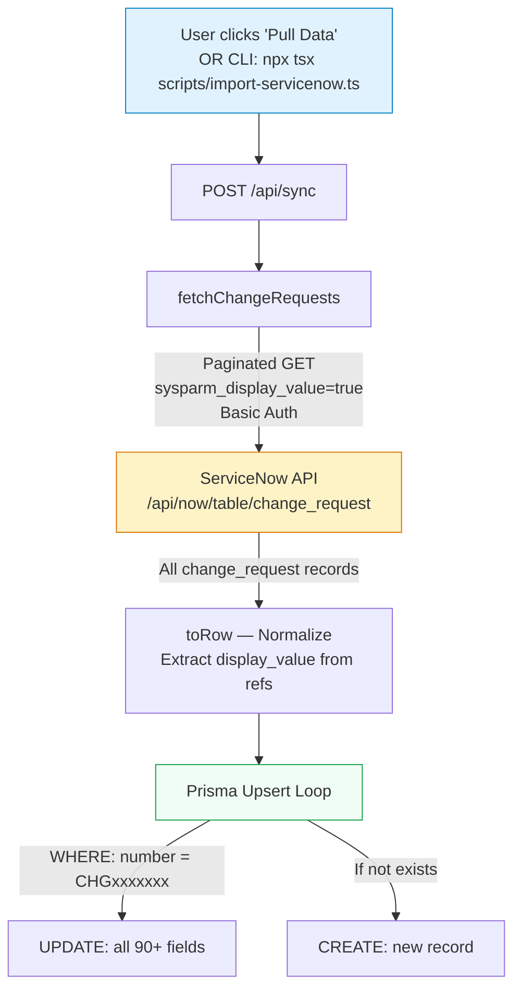
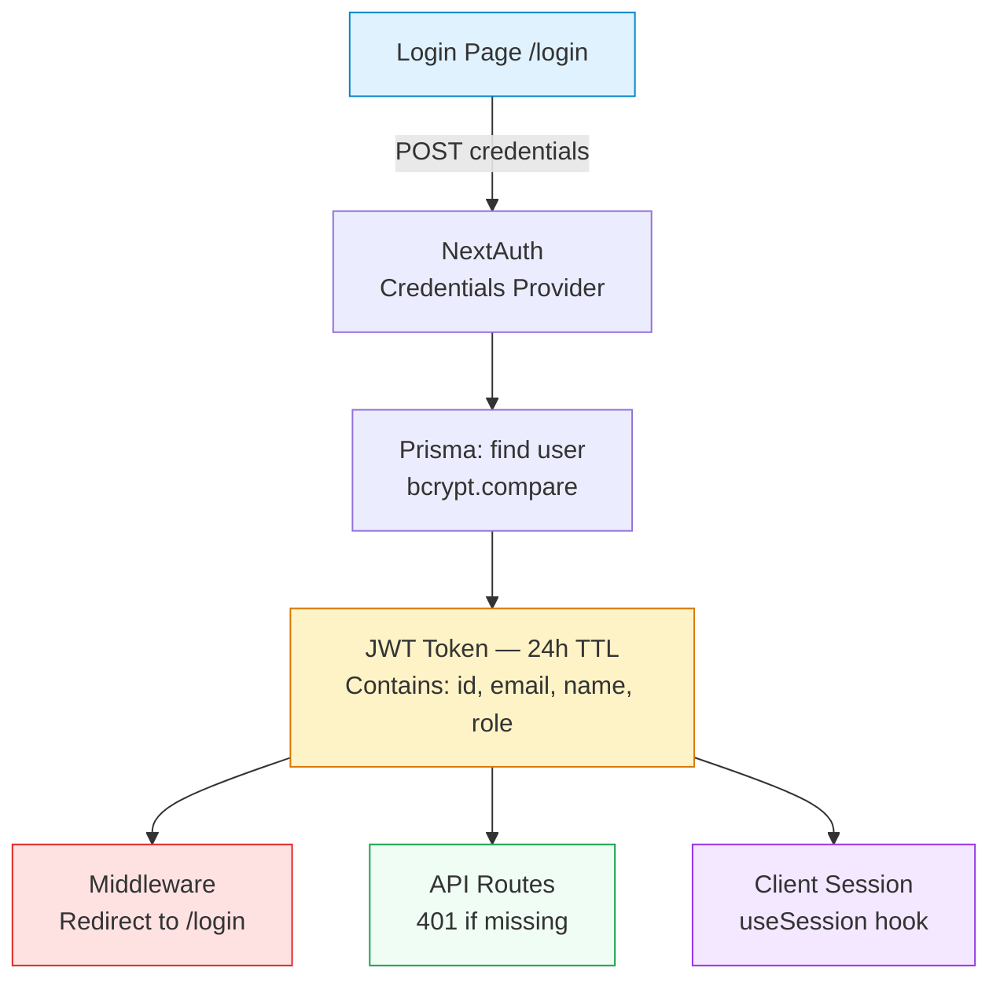
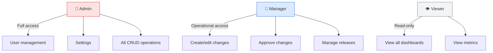
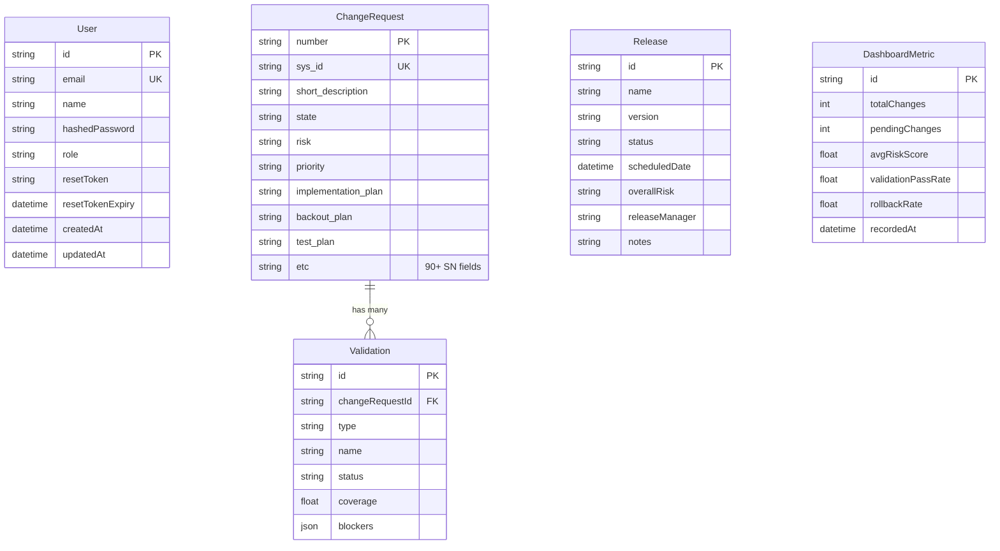
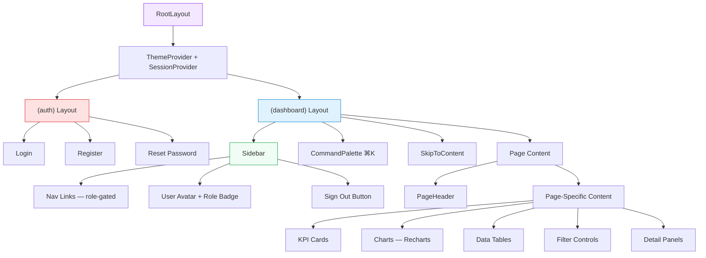
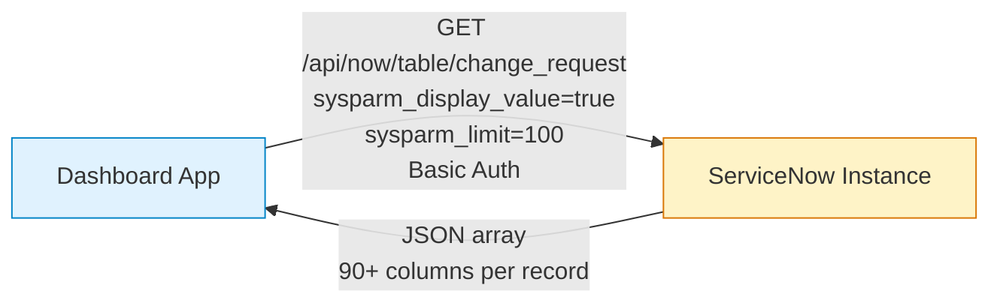

# Architecture Document — GCS Change & Release Management Dashboard

> **Version**: 1.2.0
> **Last Updated**: March 12, 2026

---

## Table of Contents

1. [System Overview](#1-system-overview)
2. [High-Level Architecture](#2-high-level-architecture)
3. [Application Layers](#3-application-layers)
4. [Routing & Page Architecture](#4-routing--page-architecture)
5. [Data Flow](#5-data-flow)
6. [Authentication & Authorization Architecture](#6-authentication--authorization-architecture)
7. [Database Architecture](#7-database-architecture)
8. [Component Architecture](#8-component-architecture)
9. [State Management](#9-state-management)
10. [External Integrations](#10-external-integrations)
11. [Design Patterns](#11-design-patterns)
12. [Security Architecture](#12-security-architecture)
13. [Performance Architecture](#13-performance-architecture)

---

## 1. System Overview

The GCS Change & Release Management Dashboard is a **monolithic full-stack web application** built on Next.js 14 with the App Router pattern. It provides real-time change management analytics sourced from ServiceNow, with role-based access control, interactive visualizations, and risk analysis capabilities.

### Architecture Style

- **Monolithic full-stack** — frontend and backend in a single Next.js deployment
- **Server-side rendering (SSR)** with client-side hydration
- **REST API** layer for data access
- **Client-side caching** via SWR for real-time updates

---

## 2. High-Level Architecture



---

## 3. Application Layers

### 3.1 Presentation Layer

| Concern | Technology | Location |
|---------|-----------|----------|
| Page rendering | React 18 + Next.js App Router | `src/app/` |
| Styling | Tailwind CSS 3.4 | Inline classes + `globals.css` |
| Charts | Recharts 3.x | Embedded in page components |
| Icons | Lucide React | Throughout UI components |
| Notifications | Sonner | Toast system in root layout |
| Theming | Custom ThemeProvider | `src/components/theme-provider.tsx` |

### 3.2 Application Layer

| Concern | Technology | Location |
|---------|-----------|----------|
| Data fetching hooks | SWR | `src/hooks/use-data.ts`, `use-analytics.ts` |
| Permission hooks | NextAuth + custom | `src/hooks/use-permissions.ts` |
| Utility functions | Custom | `src/lib/utils.ts` |
| Constants & config | Centralized module | `src/lib/constants.ts` |
| Type definitions | TypeScript interfaces | `src/lib/types.ts`, `auth-types.ts` |

### 3.3 API Layer

| Concern | Technology | Location |
|---------|-----------|----------|
| REST endpoints | Next.js Route Handlers | `src/app/api/` |
| Authentication | NextAuth.js 4 | `src/lib/auth.ts` |
| Route protection | Next.js Middleware | `src/middleware.ts` |

### 3.4 Data Layer

| Concern | Technology | Location |
|---------|-----------|----------|
| ORM | Prisma 6.x | `prisma/schema.prisma` |
| Database | SQLite (swappable) | `prisma/dev.db` |
| Seed data | TypeScript script | `prisma/seed.ts` |
| External sync | ServiceNow client | `src/lib/servicenow.ts` |

---

## 4. Routing & Page Architecture

### 4.1 Route Groups

Next.js App Router uses **route groups** (parenthesized folders) to organize pages into different layouts without affecting the URL path:

```
src/app/
├── (auth)/                     ← Auth layout (no sidebar)
│   ├── layout.tsx              ← Centered card layout
│   ├── login/page.tsx          → /login
│   ├── register/page.tsx       → /register
│   └── reset-password/page.tsx → /reset-password
│
├── (dashboard)/                ← Dashboard layout (sidebar + header)
│   ├── layout.tsx              ← Sidebar + mobile nav + command palette
│   ├── page.tsx                → /           (Overview)
│   ├── changes/page.tsx        → /changes    (Change Requests)
│   ├── impact/page.tsx         → /impact     (Impact Analysis — 4 tabs: Overview, Plan Analysis, ML Analysis, Code Change)
│   ├── analytics/page.tsx      → /analytics  (Analytics — 4 tabs: Failure Analysis, Velocity, Metrics & Trends, Change Health)
│   ├── executive/page.tsx      → /executive  (Executive Summary)
│   ├── releases/page.tsx       → /releases   (Releases & Validations)
│   ├── risk-radar/page.tsx     → /risk-radar (Risk Radar)
│   ├── confidence/page.tsx     → /confidence (Confidence Scoring)
│   ├── velocity/page.tsx       → /velocity   (Team Velocity)
│   ├── failure-analysis/page.tsx → /failure-analysis
│   └── settings/
│       ├── page.tsx            → /settings        (Dashboard Settings)
│       └── users/page.tsx      → /settings/users  (User Management)
│
└── api/                        ← API Route Handlers
    ├── auth/[...nextauth]/route.ts  ← NextAuth endpoints
    ├── auth/register/route.ts
    ├── auth/reset-password/route.ts
    ├── data/route.ts                ← GET /api/data
    ├── data/analytics/route.ts      ← GET /api/data/analytics
    ├── data/changes/route.ts        ← POST/PUT/DELETE /api/data/changes
    ├── data/plan-analysis/route.ts   ← GET /api/data/plan-analysis (ML content analysis)
    ├── admin/users/route.ts         ← Admin user management
    └── sync/route.ts                ← POST /api/sync (ServiceNow)
```

### 4.2 Layout Nesting



### 4.3 Loading States

Each dashboard route has a `loading.tsx` file that renders animated skeleton placeholders during navigation:

```
(dashboard)/
├── loading.tsx           ← Overview skeleton
├── changes/loading.tsx   ← Changes page skeleton
├── impact/loading.tsx    ← Impact page skeleton
├── metrics/loading.tsx   ← Metrics page skeleton
├── releases/loading.tsx  ← Releases page skeleton
├── settings/loading.tsx  ← Settings skeleton
└── validations/loading.tsx ← Validations skeleton
```

---

## 5. Data Flow

### 5.1 Client-Side Data Fetching (SWR)

```mermaid
graph LR
    PC[Page Component] --> UD[useData hook]
    PC --> UA[useAnalytics hook]

    UD -->|"SWR /api/data<br/>30s refresh, 5s dedup"| API1[/api/data]
    UA -->|"SWR /api/data/analytics<br/>60s refresh, 10s dedup"| API2[/api/data/analytics]

    API1 -->|Returns| D1[changeRequests<br/>releases<br/>dashboardMetrics]
    API2 -->|Returns| D2[releaseRiskRadar<br/>blastRadius<br/>confidenceScores<br/>failureAnalysis<br/>velocity<br/>rollbackIntelligence]

    style PC fill:#e0f2fe,stroke:#0284c7
    style API1 fill:#f0fdf4,stroke:#16a34a
    style API2 fill:#f0fdf4,stroke:#16a34a
```

### 5.2 API Data Processing Pipeline



### 5.3 ServiceNow Sync Flow



---

## 6. Authentication & Authorization Architecture

### 6.1 Auth Flow



### 6.2 Middleware Protection

The Next.js middleware (`src/middleware.ts`) protects all dashboard routes. Unauthenticated users are redirected to `/login`:

```typescript
// Protected route patterns:
"/", "/changes/*", "/impact/*", "/validations/*",
"/releases/*", "/metrics/*", "/settings/*"
```

### 6.3 Role-Based Access Control (RBAC)

Three-tier role system defined in `src/lib/auth-types.ts`:



Permissions are enforced at two levels:
1. **UI gating** — `usePermissions()` hook hides buttons/links based on role
2. **API enforcement** — API routes check `session.user.role` before mutations

---

## 7. Database Architecture

### 7.1 Entity Relationship Diagram



### 7.2 Design Decisions

- **ChangeRequest stores all SN fields as strings** — mirrors the ServiceNow schema exactly, avoiding data loss from field mapping
- **SQLite for development** — zero configuration; swappable to PostgreSQL/MySQL via Prisma datasource config
- **Validations as separate table** — one-to-many relationship with cascade delete
- **DashboardMetric as snapshot** — point-in-time metrics for historical tracking

---

## 8. Component Architecture

### 8.1 Component Hierarchy



### 8.2 Shared Components

| Component | File | Purpose |
|-----------|------|---------|
| `Card`, `CardHeader`, `CardTitle` | `card.tsx` | Consistent card container |
| `PageHeader` | `page-header.tsx` | Unified page title bar with actions |
| `Sidebar` | `sidebar.tsx` | Navigation with role gating |
| `CommandPalette` | `command-palette.tsx` | ⌘K search across all entities |
| `ThemeToggle` | `theme-toggle.tsx` | Dark/light mode switch |
| `RiskBadge` | `risk-badge.tsx` | Color-coded risk label |
| `RiskGauge` | `risk-gauge.tsx` | Visual risk meter |
| `StatusBadge` | `status-badge.tsx` | Status indicator |
| `Skeleton` | `skeleton.tsx` | Loading placeholder |
| `SkipToContent` | `skip-to-content.tsx` | Accessibility shortcut |

### 8.3 Custom Hooks

| Hook | File | Purpose |
|------|------|---------|
| `useData()` | `use-data.ts` | SWR-based fetch from `/api/data` (30s refresh) |
| `useAnalytics()` | `use-analytics.ts` | SWR-based fetch from `/api/data/analytics` (60s refresh) |
| `usePermissions()` | `use-permissions.ts` | Role-based permission checks |
| `useDebounce()` | `use-debounce.ts` | Debounced value for search inputs |
| `useMediaQuery()` | `use-media-query.ts` | Responsive breakpoint detection |

---

## 9. State Management

The application uses **no global state library** (e.g., Redux, Zustand). Instead, it relies on:

### 9.1 Server State (SWR)

- All server data flows through SWR hooks (`useData`, `useAnalytics`)
- SWR handles caching, deduplication, revalidation, and error retries
- Global `mutate` function triggers refetches after mutations

### 9.2 Client State (React useState)

- Each page manages its own local UI state (filters, search, selected items, active tabs)
- No cross-page state sharing needed — each page fetches its own data

### 9.3 Session State (NextAuth)

- JWT tokens stored in HTTP-only cookies
- `useSession()` hook provides current user info client-side
- `getServerSession()` provides session info server-side in API routes

### 9.4 Theme State (localStorage)

- Dark/light preference stored in `localStorage`
- `ThemeProvider` reads and applies on mount
- `ThemeToggle` component controls switching

---

## 10. External Integrations

### 10.1 ServiceNow



- **Protocol**: REST over HTTPS
- **Authentication**: HTTP Basic Auth
- **Data direction**: One-way pull (SN → local DB)
- **Sync strategy**: Full table sync with upsert (idempotent)
- **Trigger**: Manual ("Pull Data" button) or CLI script

---

## 11. Design Patterns

### 11.1 Patterns Used

| Pattern | Where | Purpose |
|---------|-------|---------|
| **Route Groups** | `(auth)`, `(dashboard)` | Separate layouts without URL impact |
| **Custom Hooks** | `src/hooks/` | Encapsulate data fetching and business logic |
| **Singleton** | `src/lib/prisma.ts` | Single Prisma client instance |
| **Provider Pattern** | `SessionProvider`, `ThemeProvider` | React context for auth and theme |
| **Composition** | `PageHeader`, `Card` | Reusable UI building blocks |
| **Centralized Constants** | `src/lib/constants.ts` | Eliminate magic numbers |
| **Type-Safe API** | TypeScript interfaces | End-to-end type safety |
| **Middleware Guard** | `src/middleware.ts` | Declarative route protection |
| **SWR Stale-While-Revalidate** | Data hooks | Instant cached UI + background refresh |

### 11.2 File Organization Convention

```
Feature-based within App Router:
  src/app/(dashboard)/[feature]/
    ├── page.tsx       ← Page component (server or client)
    ├── layout.tsx     ← Optional feature layout
    └── loading.tsx    ← Skeleton loader

Shared code by concern:
  src/components/    ← Reusable UI components
  src/hooks/         ← Custom React hooks
  src/lib/           ← Utilities, types, config, auth
```

---

## 12. Security Architecture

| Layer | Mechanism |
|-------|-----------|
| **Transport** | HTTPS in production |
| **Authentication** | NextAuth.js JWT (24h expiry) |
| **Password storage** | bcryptjs hashing |
| **Route protection** | Next.js middleware redirects unauthenticated users |
| **API protection** | `getServerSession()` check in every route handler |
| **Role enforcement** | Permission matrix checked in UI + API |
| **Secrets management** | Environment variables (`.env`, never committed) |
| **CSRF** | NextAuth built-in CSRF protection |
| **XSS** | React's default JSX escaping |

---

## 13. Performance Architecture

| Technique | Implementation |
|-----------|---------------|
| **SWR caching** | Client-side cache with dedup (5–10s intervals) |
| **Auto-refresh** | Background revalidation (30s data, 60s analytics) |
| **Code splitting** | Next.js automatic per-route code splitting |
| **Font optimization** | `next/font/google` (Inter, swap display) |
| **Image optimization** | Next.js `<Image>` component where used |
| **Bundle analysis** | `next build` with webpack analyzer |
| **Loading states** | Skeleton components prevent layout shift |
| **Responsive rendering** | `useMediaQuery` hook avoids unnecessary renders |
| **Database queries** | Prisma's query optimization + relation includes |
