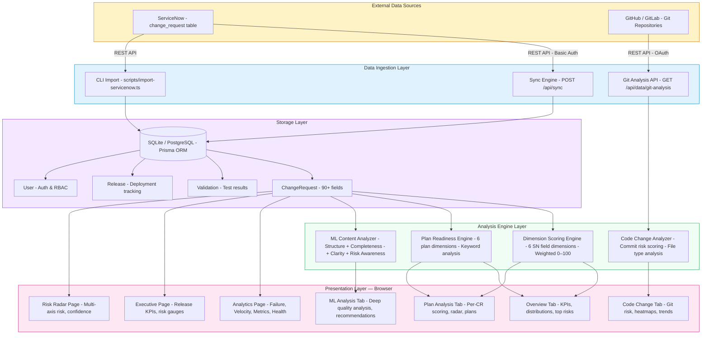
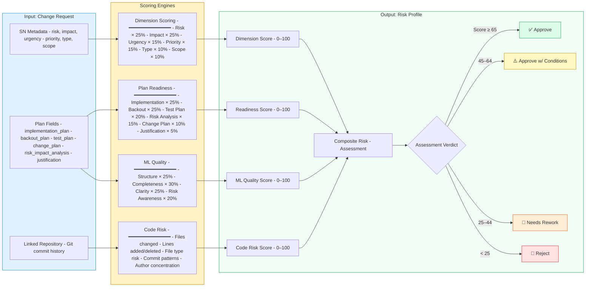
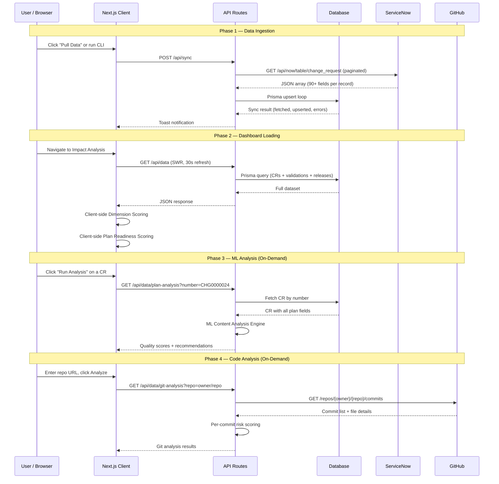
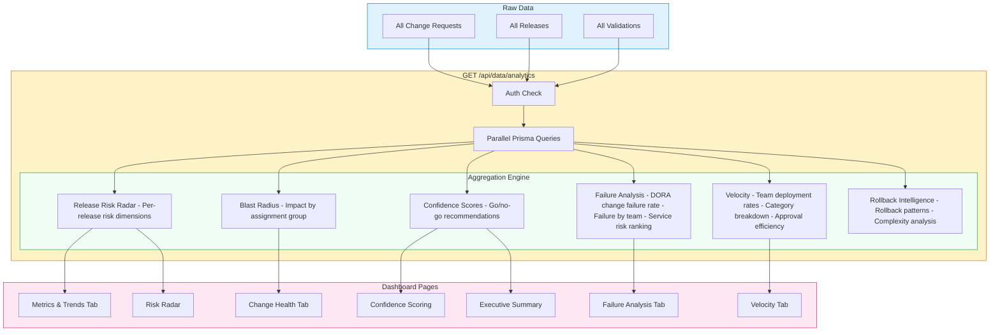
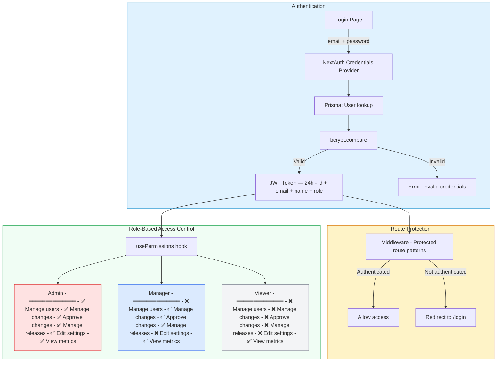
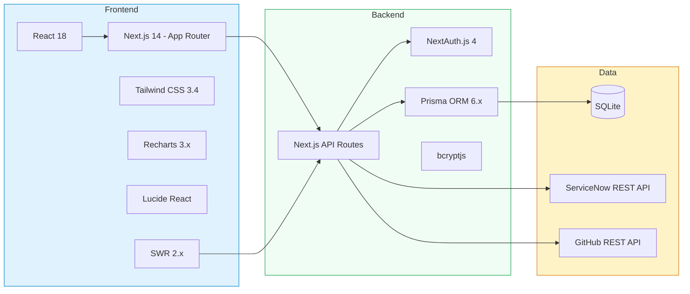

# Change Management Analysis — Architecture

> **Version**: 1.3.0
> **Last Updated**: April 23, 2026

---

## System Architecture Overview

---

## Analysis Pipeline — Per Change Request

---

## Data Flow — End to End

---

## Analytics Processing Pipeline

---

## Authentication & Authorization Flow

---

## Technology Stack

