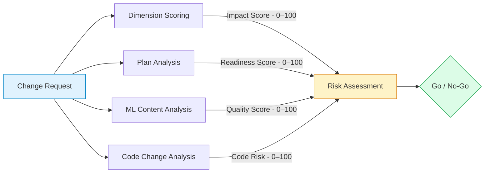
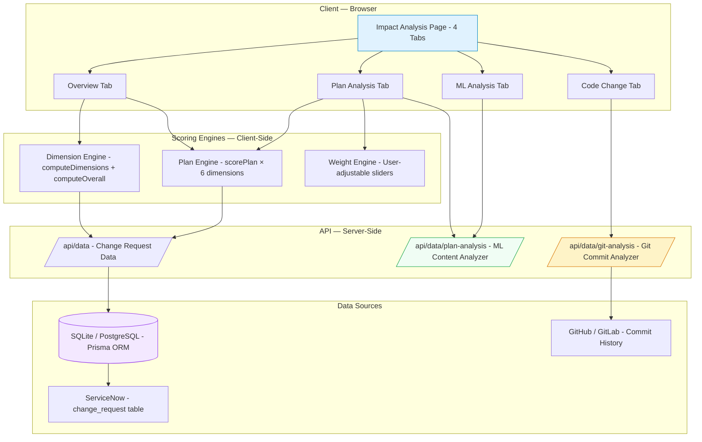
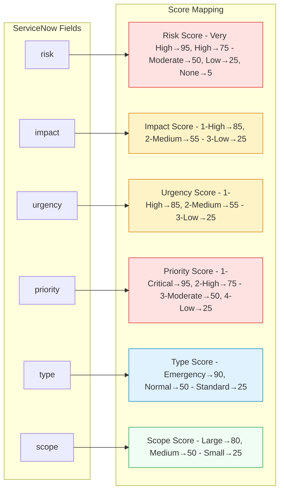
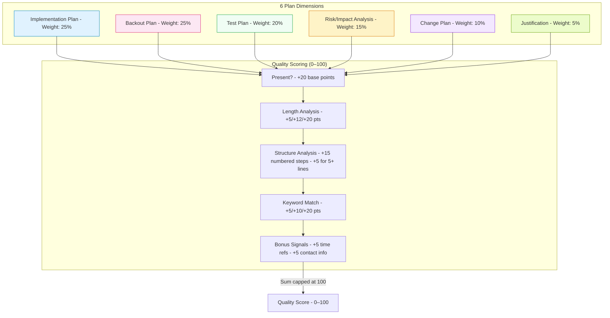
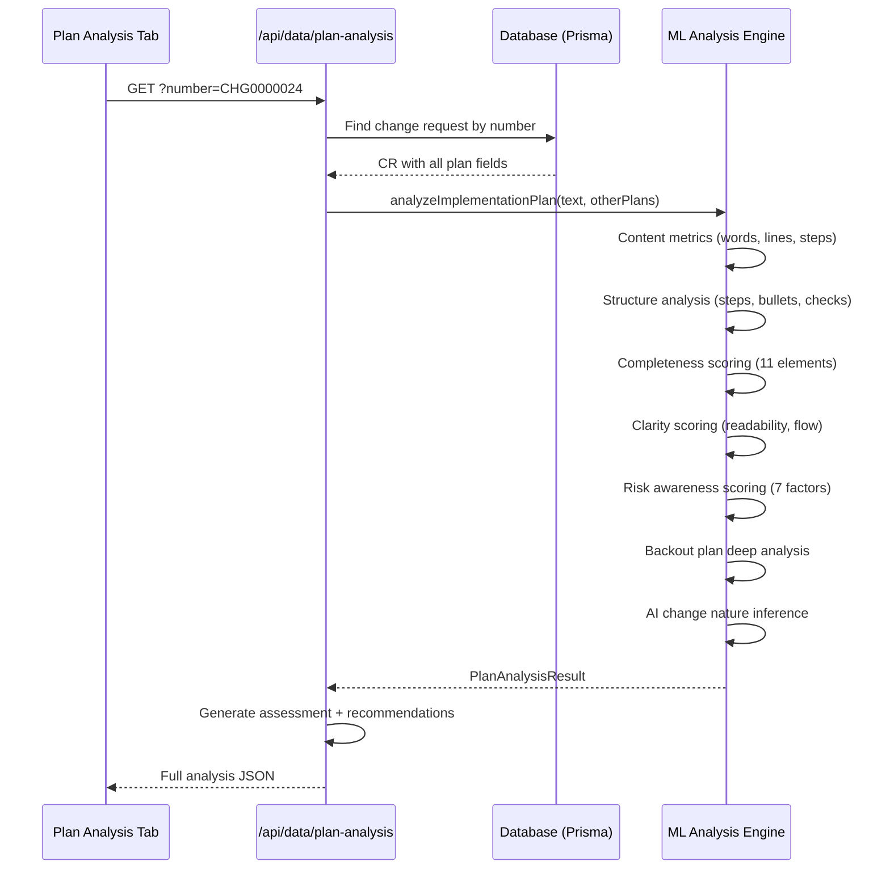
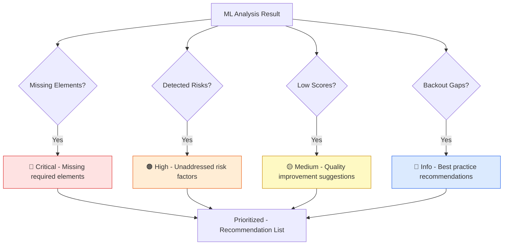
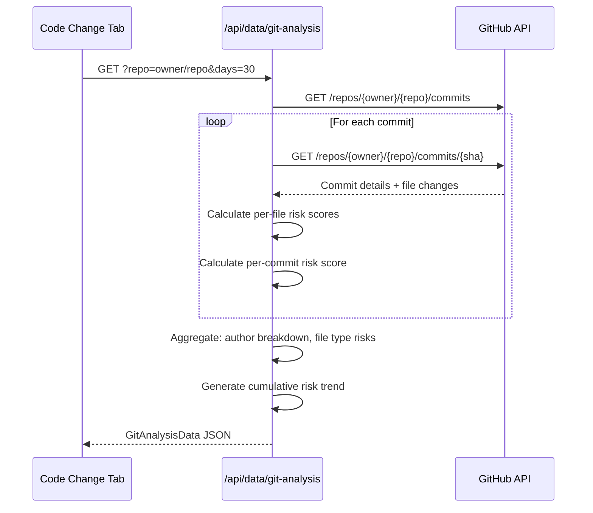
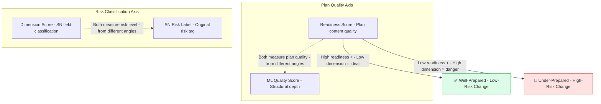
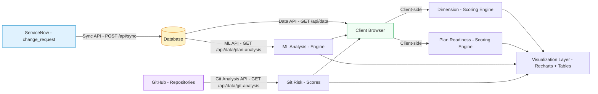

# Impact Analysis — Methodology & Scoring Guide

> **Version**: 1.3.0
> **Last Updated**: April 23, 2026

---

## Table of Contents

1. [Overview](#1-overview)
2. [Impact Analysis Architecture](#2-impact-analysis-architecture)
3. [Dimension Scoring (Impact Score)](#3-dimension-scoring-impact-score)
4. [Plan Readiness Scoring](#4-plan-readiness-scoring)
5. [ML Content Analysis](#5-ml-content-analysis)
6. [Code Change Analysis](#6-code-change-analysis)
7. [Score Interpretation Guide](#7-score-interpretation-guide)
8. [Data Flow](#8-data-flow)
9. [Customization](#9-customization)

---

## 1. Overview

The **Impact Analysis** page provides a comprehensive, multi-layered risk and readiness assessment for every change request. It combines four complementary analysis approaches:



| Analysis Layer | What It Measures | Data Source |
|---------------|-----------------|-------------|
| **Dimension Scoring** | Risk classification from ServiceNow fields | SN `risk`, `impact`, `urgency`, `priority`, `type`, `scope` |
| **Plan Readiness** | Quality and completeness of change plans | SN `implementation_plan`, `backout_plan`, `test_plan`, `change_plan`, `risk_impact_analysis`, `justification` |
| **ML Content Analysis** | Deep NLP-based structural and content quality | Same plan text fields, analyzed by pattern-matching engine |
| **Code Change Analysis** | Git commit-level code risk factors | GitHub/GitLab repository commit history |

---

## 2. Impact Analysis Architecture



---

## 3. Dimension Scoring (Impact Score)

The **Dimension Score** quantifies the inherent risk/impact classification of a change request based on its ServiceNow metadata fields. This is displayed as the **"Dimension"** KPI on the individual plan analysis view.

### 3.1 Formula

```
Dimension Score = Σ (dimension_value × weight)
```

Where each dimension is mapped from a ServiceNow field to a 0–100 score.

### 3.2 Dimension Mapping



### 3.3 Default Weights

| Dimension | Weight | ServiceNow Field | Score Range |
|-----------|--------|-------------------|-------------|
| **Risk** | 25% | `risk` | 5–95 |
| **Impact** | 25% | `impact` | 25–85 |
| **Urgency** | 15% | `urgency` | 25–85 |
| **Priority** | 15% | `priority` | 25–95 |
| **Type** | 10% | `type` | 25–90 |
| **Scope** | 10% | `scope` | 25–80 |

**Total**: 100%

### 3.4 Score Interpretation

| Score Range | Classification | Color | Meaning |
|-------------|---------------|-------|---------|
| **75–100** | Critical | 🔴 Red | Highest risk — requires senior review |
| **50–74** | High | 🟠 Orange | Elevated risk — additional scrutiny needed |
| **25–49** | Medium | 🟡 Amber | Moderate risk — standard process |
| **0–24** | Low | 🟢 Green | Minimal risk — low-touch approval |

### 3.5 Weight Customization

Users can adjust dimension weights via sliders on the individual CR detail view. The **Dimension Scoring Formula** card (available when viewing a specific CR) allows:

- Drag sliders for each dimension (0–100%)
- Real-time score recalculation
- Reset to defaults button
- Total weight validation (warns if ≠ 100%)

---

## 4. Plan Readiness Scoring

The **Plan Readiness Score** evaluates the quality and completeness of the six plan fields attached to each change request. This is displayed as the **"Readiness"** KPI.

### 4.1 Formula

```
Readiness Score = Σ (plan_quality × weight)
```

### 4.2 Plan Dimensions



### 4.3 Quality Scoring Algorithm

Each plan field is scored independently on a 0–100 scale using keyword-based content analysis:

| Factor | Points | Criteria |
|--------|--------|----------|
| **Base** | +20 | Any non-empty content present |
| **Length: Brief** | +5 | Content exists but short |
| **Length: Moderate** | +12 | Moderate detail (100–500 chars) |
| **Length: Detailed** | +20 | Comprehensive content (500+ chars) |
| **Structure: Steps** | +15 | Contains numbered or bulleted steps |
| **Structure: Lines** | +5 | 5 or more lines of content |
| **Keywords: Minimal** | +5 | < 25% keyword match rate |
| **Keywords: Partial** | +10 | 25–50% keyword match rate |
| **Keywords: Good** | +20 | ≥ 50% keyword match rate |
| **Bonus: Time refs** | +5 | Contains time/date references |
| **Bonus: Contacts** | +5 | Contains contact/escalation info |

**Maximum score**: 100 (capped)

### 4.4 Keyword Sets Per Dimension

| Dimension | Keywords Scanned |
|-----------|-----------------|
| **Implementation Plan** | step, deploy, install, configure, verify, validate, monitor, rollout, pre-check, post-check, approval, schedule |
| **Backout Plan** | revert, rollback, restore, undo, previous, snapshot, backup, recovery, failover, downtime |
| **Test Plan** | test, verify, validate, smoke, regression, acceptance, integration, unit, performance, security, coverage |
| **Risk/Impact Analysis** | risk, impact, mitigation, contingency, fallback, probability, severity, exposure, vulnerability, dependency |
| **Change Plan** | *(Same as Implementation Plan)* — Overall change execution strategy |
| **Justification** | business, requirement, need, value, benefit, compliance, security, improvement |

### 4.5 Readiness Interpretation

| Score | Label | Color | Meaning |
|-------|-------|-------|---------|
| **75–100** | Well Prepared | 🟢 Green | All plans comprehensive and well-structured |
| **50–74** | Adequate | 🟡 Amber | Plans present but could use more detail |
| **25–49** | Gaps Found | 🟠 Orange | Significant plan gaps — needs improvement |
| **0–24** | Critical Gaps | 🔴 Red | Plans missing or severely deficient |

---

## 5. ML Content Analysis

The **ML Content Analysis** engine performs deep, server-side natural language analysis on the implementation plan and supporting plan fields. It goes beyond keyword matching to assess structural quality, completeness, clarity, and risk awareness.

### 5.1 Architecture



### 5.2 ML Quality Formula

```
ML Quality = Structure × 25% + Completeness × 30% + Clarity × 25% + Risk Awareness × 20%
```

### 5.3 Quality Dimensions

#### Structure Score (0–100)

Evaluates how well-organized the plan is:

| Factor | Points |
|--------|--------|
| Numbered steps present | +25 |
| Bullet points (if no numbered steps) | +15 |
| 5+ lines of content | +10 |
| 10+ lines of content | +10 |
| 5+ identifiable steps | +15 |
| Both pre-checks and post-checks | +15 |
| Base score | +10 |

#### Completeness Score (0–100)

Evaluates coverage of essential plan elements:

| Element Checked | Points Each |
|----------------|-------------|
| Pre-implementation checks | +8 |
| Post-implementation validation | +8 |
| Verification steps | +8 |
| Timeline/schedule references | +8 |
| Contact/escalation info | +8 |
| Rollback references | +8 |
| Approval gates | +8 |
| Monitoring steps | +8 |
| Backout duration estimate | +8 |
| Log review steps | +8 |
| Audit trail documentation | +8 |
| Word count bonus (100+) | +5 |
| Word count bonus (300+) | +7 |
| Base score | +10 |

#### Clarity Score (0–100)

Evaluates readability and logical flow:

| Factor | Points |
|--------|--------|
| Average words per line < 25 | +15 |
| Average words per line > 5 | +10 |
| Sequence words (first, then, next, after, finally) | +15 |
| Numbered steps present | +20 |
| Conditional handling (if, when, should) | +10 |
| 50+ total words | +10 |
| Base score | +20 |

#### Risk Awareness Score (0–100)

Evaluates how well risk is addressed:

| Factor | Points |
|--------|--------|
| Rollback/revert references | +20 |
| Risk/impact/mitigation keywords | +15 |
| Failure/error acknowledgment | +10 |
| Downtime/outage awareness | +10 |
| Monitoring steps | +15 |
| Backup/snapshot mentions | +15 |
| Communication/stakeholder plans | +10 |
| Pre-checks present | +5 |

### 5.4 Enhanced Detection Features

The ML engine also performs advanced analysis:

#### Backout Plan Deep Analysis
- **Duration estimate** — Detects time references (e.g., "30 minutes")
- **Sequential steps** — Checks for numbered rollback steps
- **Trigger criteria** — Identifies when-to-rollback conditions
- **Escalation path** — Detects escalation procedures

#### AI Change Nature Insights
- **Version upgrade detection** — Identifies from/to version patterns (e.g., `3.2.1 → 4.0.0`)
- **Major version analysis** — Flags major version bumps as higher risk
- **Firmware/runtime detection** — Identifies low-level changes
- **OS/kernel changes** — Highest impact tier classification
- **Infrastructure scope** — Detects multi-server changes
- **Rolling vs big-bang** — Checks for phased deployment strategy
- **Data impact** — Schema/migration detection
- **Security implications** — CVE, TLS, encryption keywords
- **Downtime assessment** — Zero-downtime vs. planned outage
- **Multi-DC coordination** — Cross-datacenter change detection

#### Application & Change Profiling
- **Change type** classification (deployment, config, patch, migration, etc.)
- **Risk tier** assignment (Critical, High, Medium, Low)
- **Complexity** assessment (High, Medium, Low)
- **Technology stack** inference from plan content
- **Service category** detection

### 5.5 Assessment Verdicts

Based on the overall ML quality score, each CR receives an assessment:

| ML Score | Verdict | Action |
|----------|---------|--------|
| **65–100** | ✅ Approve | Safe to proceed |
| **45–64** | ⚠️ Approve with Conditions | Address noted gaps before proceeding |
| **25–44** | 🔶 Needs Rework | Significant gaps — return for improvement |
| **0–24** | 🛑 Reject | Critical deficiencies — plan is inadequate |

### 5.6 Recommendations Engine

The ML analysis generates severity-rated recommendations:



---

## 6. Code Change Analysis

The **Code Change Analysis** tab provides git-level risk assessment by analyzing commit history from linked repositories.

### 6.1 Architecture



### 6.2 Risk Factors

Each commit is scored based on:

| Factor | Weight | High-Risk Signals |
|--------|--------|-------------------|
| **Files changed** | Variable | > 10 files = elevated risk |
| **Lines added/deleted** | Variable | Large diffs = higher risk |
| **File types** | Variable | Config files, migrations, infrastructure = higher risk |
| **Commit message** | Variable | "hotfix", "urgent", "revert" = risk indicators |
| **Author concentration** | Variable | Single author for critical changes |

### 6.3 Visualizations

- **File Type Risk Breakdown** — Bar chart of risk by file extension
- **Commit Message Pattern Analysis** — Classification of commit types
- **Cumulative Risk Trend** — Area chart showing risk accumulation over time
- **Directory Risk Heatmap** — Risk distribution across project directories
- **Author Activity Heatmap** — Day-of-week commit activity grid
- **Repository Risk Profile Radar** — Multi-axis risk visualization
- **AI Code Change Insights** — Automated risk signal synthesis

---

## 7. Score Interpretation Guide

### 7.1 KPI Summary (Individual CR Detail View)

When viewing a specific change request in Plan Analysis, four KPIs are displayed:

| KPI | Source | What It Measures |
|-----|--------|-----------------|
| **Readiness** | Plan Analysis engine | Weighted plan quality score (0–100) |
| **Dimension** | Dimension Scoring engine | Weighted SN field risk classification (0–100) |
| **ML Quality** | ML Content Analysis API | NLP-based structural quality (0–100) |
| **SN Risk** | ServiceNow `risk` field | Raw risk label from ServiceNow |

### 7.2 How the Scores Relate



- **Readiness** and **ML Quality** both assess plan quality but from different angles:
  - Readiness uses keyword density and content presence
  - ML Quality analyzes structure, completeness, clarity, and risk awareness
- **Dimension** and **SN Risk** both reflect risk classification:
  - Dimension is a computed weighted score from 6 SN fields
  - SN Risk is the raw ServiceNow risk label

**Ideal state**: High Readiness + High ML Quality + Low Dimension Score = well-prepared, low-risk change.

---

## 8. Data Flow

### 8.1 End-to-End Analysis Pipeline



### 8.2 Processing Location

| Analysis | Where It Runs | Why |
|----------|--------------|-----|
| Dimension Scoring | **Client-side** (browser) | Instant recalculation when weights change |
| Plan Readiness | **Client-side** (browser) | Instant recalculation when weights change |
| ML Content Analysis | **Server-side** (API route) | Heavy NLP processing, cross-field analysis |
| Code Change Analysis | **Server-side** (API route) | External GitHub API calls |

---

## 9. Customization

### 9.1 Adjustable Weights

Both scoring systems support user-adjustable weights via sliders:

- **Dimension weights** — Adjust how much each SN field contributes to the impact score
- **Plan weights** — Adjust how much each plan dimension contributes to the readiness score

Changes are applied in real-time. Use the **Reset** button to restore defaults.

### 9.2 Dimension Score Overrides

Users can manually override individual dimension scores for a specific CR. This is useful when:
- The ServiceNow field value is incorrect or missing
- A special circumstance warrants a different risk classification
- What-if analysis is needed

Overrides are indicated with a visual marker and can be cleared individually.

### 9.3 API Endpoint

The ML Content Analysis is available as a standalone API:

```
GET /api/data/plan-analysis?number=CHG0000024
```

**Response** includes:
- `planAnalysis` — Full `PlanAnalysisResult` object
- `assessment` — Verdict (Approve / Approve with Conditions / Needs Rework / Reject)
- `recommendations` — Array of severity-rated action items
- `changeProfile` — Inferred change type, risk tier, complexity
- `applicationProfile` — Application name, service category, criticality
