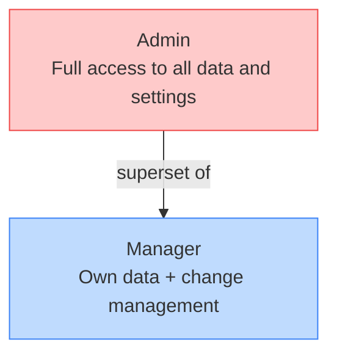
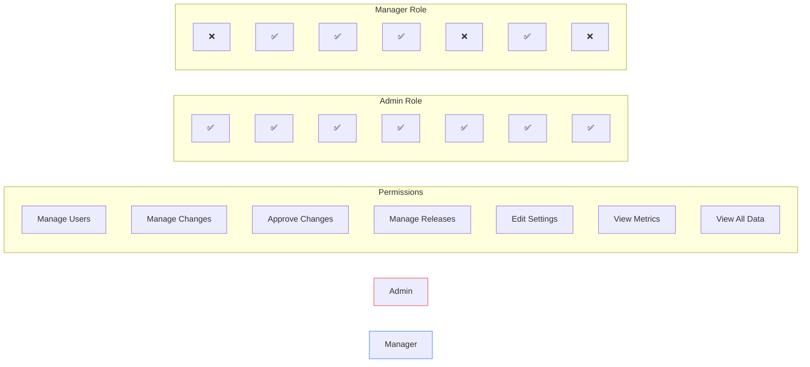
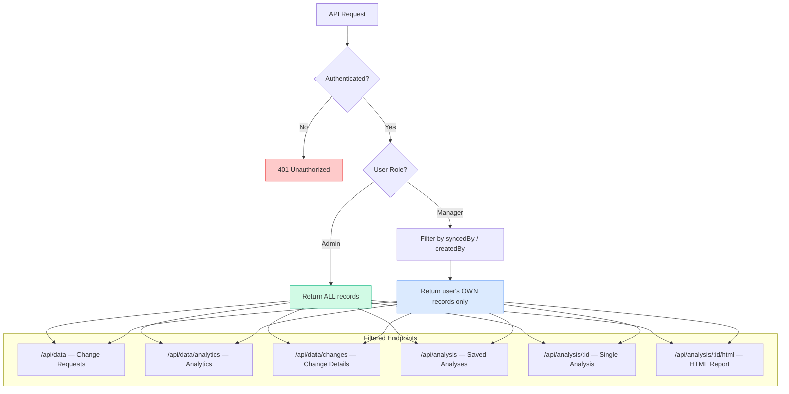
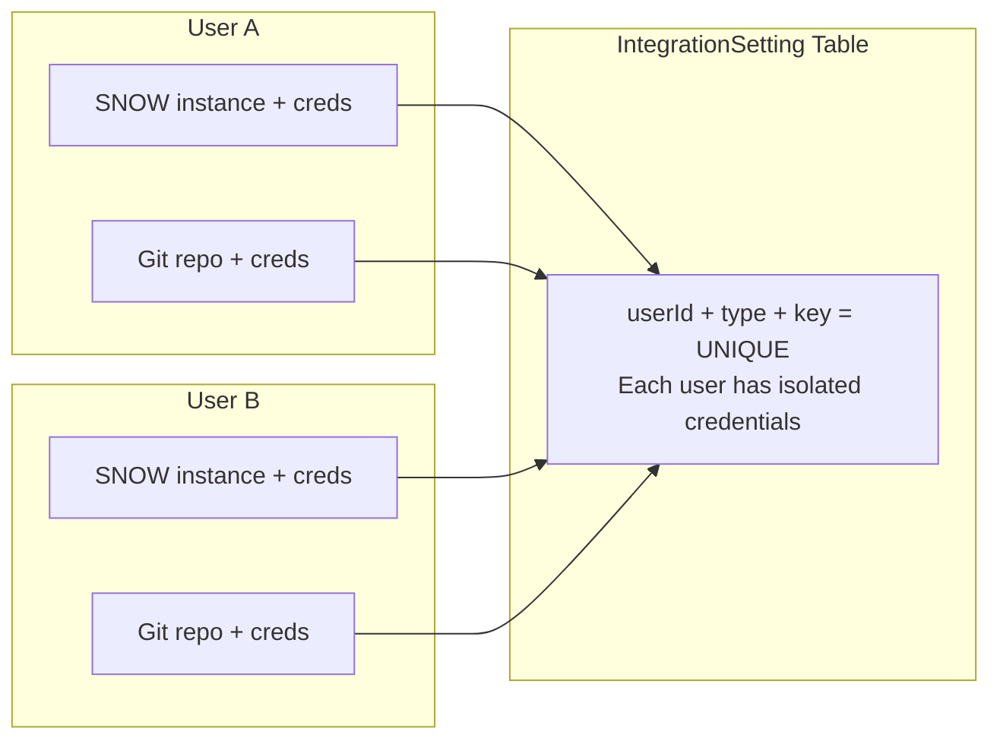

# Access Control Model

Role-based access control (RBAC) architecture for the dashboard.

## Role Hierarchy

## Permission Matrix

## Data Visibility Flow

## Credential Isolation

## Page Access Rules

| Page | Path | Auth Required | Admin Only | Data Filtered |
|------|------|:---:|:---:|:---:|
| Overview | `/` | ✅ | — | By syncedBy |
| Change Requests | `/changes` | ✅ | — | By syncedBy |
| Impact Analysis | `/impact` | ✅ | — | By syncedBy |
| Code Analysis | `/code-analysis` | ✅ | — | Own credentials |
| Reports | `/reports` | ✅ | — | By createdBy |
| Analytics | `/analytics` | ✅ | — | By syncedBy |
| Integrations | `/settings/integrations` | ✅ | — | Per-user creds |
| User Management | `/settings/users` | ✅ | ✅ | — |
| Account | `/settings/account` | ✅ | — | Own account |
