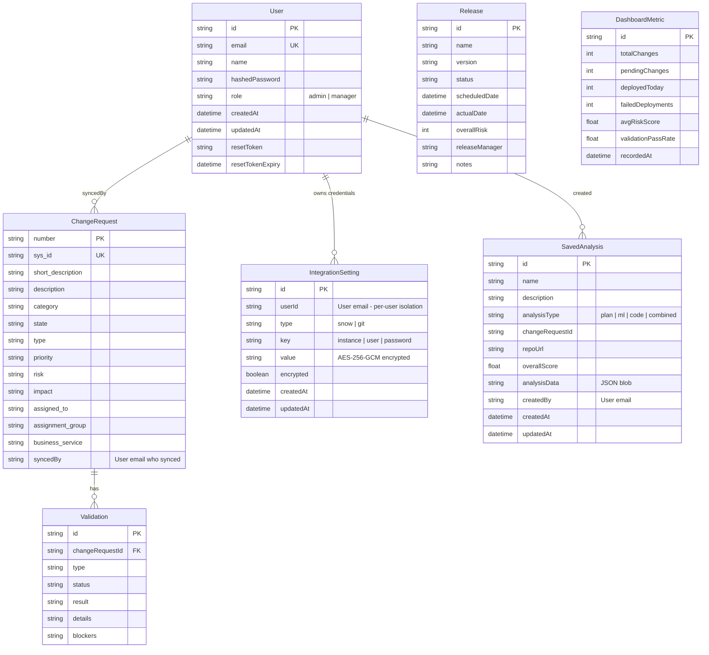

# Database Schema

Entity-relationship diagram for the SQLite database (Prisma ORM).

## ER Diagram

## Key Constraints

| Table | Unique Constraint | Purpose |
|-------|-------------------|---------|
| `User` | `email` | One account per email |
| `ChangeRequest` | `sys_id` | Deduplicate ServiceNow records |
| `IntegrationSetting` | `(userId, type, key)` | Per-user credential isolation |
| `SavedAnalysis` | — | Indexed on `createdBy`, `analysisType`, `changeRequestId` |

## Data Ownership

- **ChangeRequest.syncedBy** — Tracks which user synced the record; non-admin users only see CRs they synced
- **SavedAnalysis.createdBy** — Tracks who created the analysis; non-admin users only see their own
- **IntegrationSetting.userId** — Each user stores their own encrypted credentials independently
