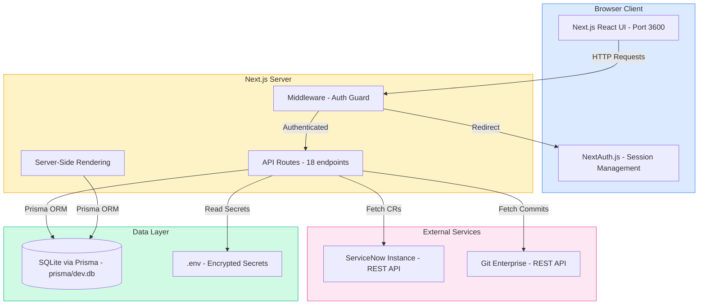

# System Overview

High-level architecture of the GCS Release Change Analysis Dashboard.

## Technology Stack

| Layer | Technology |
|-------|-----------|
| **Frontend** | React 19, Next.js 14, Recharts, TailwindCSS, Lucide Icons |
| **Auth** | NextAuth.js, bcryptjs, JWT |
| **Backend** | Next.js API Routes (Node.js) |
| **Database** | SQLite + Prisma ORM |
| **Encryption** | AES-256-GCM (credentials at rest) |
| **External APIs** | ServiceNow REST API, GitHub Enterprise REST API |
| **Testing** | Jest, Testing Library |
